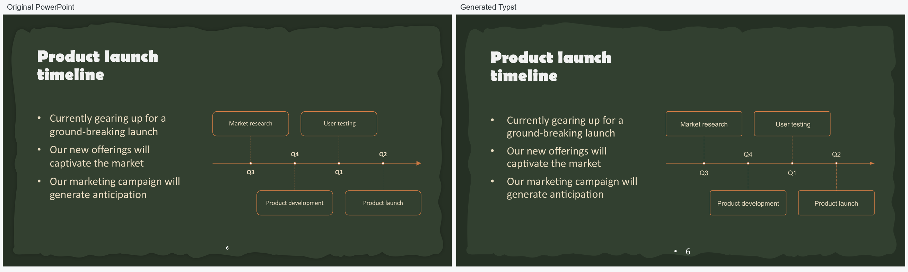
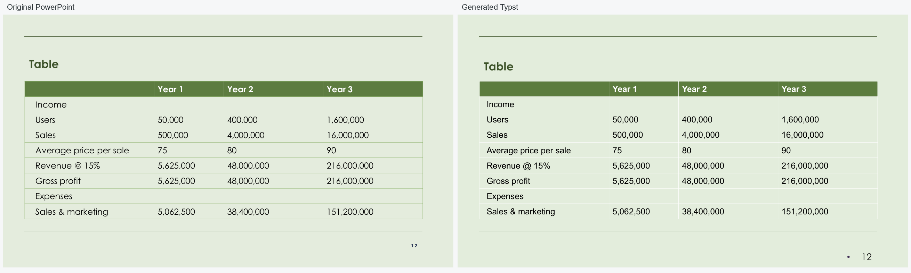
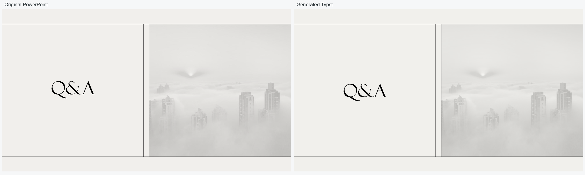
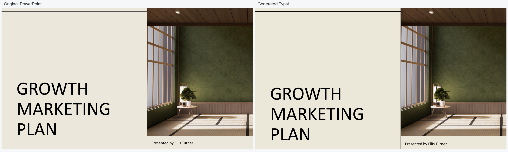
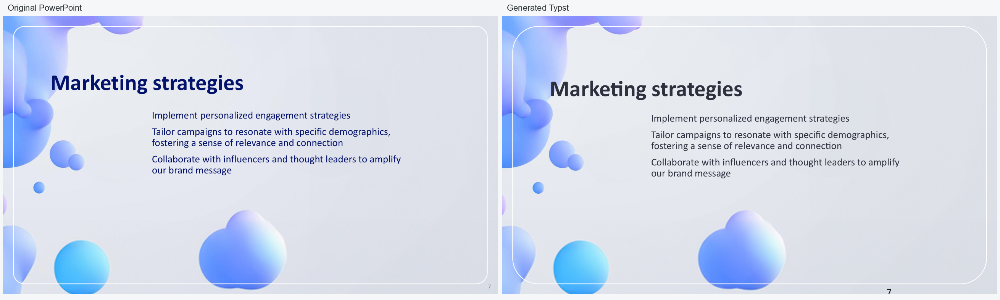

# pptx-typst

`pptx-typst` converts PowerPoint presentations (`.pptx`) to editable Typst source and converts a bounded Typst presentation subset back to PowerPoint.

Version 0.1.0 packages the existing proof of concept. The forward converter supports common text, image, shape, table, layout, and transparency cases. Tables preserve cell text, dimensions, alignment, fills, and common borders; merged cells remain unsupported. SmartArt with a stored PowerPoint drawing cache is included as vector artwork; its text is rendered in the SVG rather than emitted as independently editable Typst text. The converters preserve reusable PowerPoint masters and layouts through explicit `PptxMaster`, `PptxLayout`, and `PptxSlide` declarations. The reverse converter also accepts legacy `#Root` / `#Place` projects, including basic rectangular tables; it does not interpret arbitrary Typst. Font metrics, line wrapping, charts, complex masks, and grouped editability can differ from the source.

## Converted deck examples

Five editable Typst projects from the 29-deck template set are included below. The source PowerPoint decks were first copied and adjusted to use fonts available on this Windows machine; the source `.pptx` files are not included. `quarterly_marketing_meeting` has been refreshed from the **Outdoor exploration presentation** deck. The separate [`field_forward_milestone9`](examples/field_forward_milestone9/) reference project is preserved and is not part of these five examples.

The comparisons use the same source and generated slide numbers. They show representative results, not a guarantee of pixel-identical rendering; font metrics and some PowerPoint constructs can still differ.

<table>
  <tr>
    <td><strong>Quarterly marketing meeting · slide 6</strong><br><a href="docs/images/example-comparisons/quarterly-marketing-meeting.png"></a><br><a href="examples/quarterly_marketing_meeting/">Typst project</a></td>
    <td><strong>Back to school night · slide 12</strong><br><a href="docs/images/example-comparisons/back-to-school-night.png"></a><br><a href="examples/back_to_school_night/">Typst project</a></td>
  </tr>
  <tr>
    <td><strong>Classical neutrals marketing · slide 15</strong><br><a href="docs/images/example-comparisons/classical-neutrals-marketing.png"></a><br><a href="examples/classical_neutrals_marketing/">Typst project</a></td>
    <td><strong>Japandi linear marketing · slide 1</strong><br><a href="docs/images/example-comparisons/japandi-marketing.png"></a><br><a href="examples/japandi_marketing/">Typst project</a></td>
  </tr>
  <tr>
    <td><strong>Blue spheres · slide 7</strong><br><a href="docs/images/example-comparisons/blue-spheres.png"></a><br><a href="examples/blue_spheres/">Typst project</a></td>
    <td></td>
  </tr>
</table>

Each project includes readable `main.typ`, its helper template, shared media, an asset manifest, a conversion report, and a font preflight report. Compile and optionally export one from the repository root:

```console
typst compile examples/quarterly_marketing_meeting/main.typ quarterly-preview.pdf
typst-to-pptx examples/quarterly_marketing_meeting/main.typ --output quarterly-roundtrip.pptx
```

## Install

Python 3.10–3.13 is supported. Other Python versions have not been validated.

This project has not yet been published to PyPI. From a local clone, install it with:

```console
python -m pip install .
```

The forward converter can produce Typst source without the Typst compiler. To render the output as PDF, install the [Typst CLI](https://typst.app/) separately. It keeps the PowerPoint text point sizes and text-frame coordinates, resolves inherited text and bullet styles by default, and preserves bullet hanging indents. It tries the requested font followed by Typst's bundled Libertinus Serif. If the requested font is unavailable, fallback glyph metrics can still change wrapping and line appearance.

Core conversion is exercised by CI on Windows, Linux, and macOS. Windows EMF/WMF rendering uses GDI+ through the packaged PowerShell script. Linux and macOS can use Inkscape for those formats; if it is missing, the source media is retained and the conversion report explains that the object will not render in Typst. SVG masking and SVG-to-PowerPoint rendering use CairoSVG and need a native Cairo library. If it is unavailable, forward conversion keeps the unmasked original and reports the loss; reverse conversion reports the SVG object as unsupported while continuing with other objects. The Inkscape-installed rendering path was not available for validation on the Windows release-preparation machine.

## Convert PowerPoint to Typst

```console
pptx-to-typst presentation.pptx --output presentation-typst
```

This creates `main.typ`, `template.typ`, `asset_manifest.json`, and a shared `assets/media/` directory. Compile the result with:

```console
typst compile presentation-typst/main.typ presentation.pdf
```

Mask and text handling options remain available. Run `pptx-to-typst --help` to see them.
Use `--layout-mode flat` to keep the legacy output that repeats inherited master/layout artwork inside each slide.

## Convert Typst to PowerPoint

```console
typst-to-pptx presentation-typst/main.typ --output presentation-roundtrip.pptx
```

The converter writes `conversion_report.json` next to the `.pptx` output. It reports constructs outside the supported subset.

Check font availability before delivery:

```console
pptx-typst-fonts presentation-typst/main.typ --report presentation-typst/font_report.json
```

Pass the same `--font-path` used for `typst compile` to check custom Typst fonts. A font directory supplied to Typst does not install or embed fonts for PowerPoint. Add `--pptx`, `--typst-pdf`, and `--powerpoint-pdf` to compare source declarations, exported DrawingML, and fonts extracted from actual renders. Platform inventories are best effort; the report uses `unknown` when a check cannot be performed. No coordinates or font declarations are changed by the preflight.

Use `pptx-typst-validate original.pptx presentation-typst` to compare source placement data with the generated Typst project. The report distinguishes unsupported objects from approximations and includes affected slide, source shape ID, source type, fallback, bounds when known, and expected loss.

## Start a Typst presentation

Create a starter project with a supported `main.typ` and helper module:

```console
pptx-typst init my-deck
typst compile my-deck/main.typ my-deck/preview.pdf
typst-to-pptx my-deck/main.typ --output my-deck.pptx
```

The initialized deck contains three editable example slides using one shared master and three layouts (cover, story, and insights). Original translucent SVG overlays are installed in `my-deck/assets/` and reused through the hierarchy. Sample copy, quote, and metrics are illustrative placeholders.

To generate just the reusable module, run `pptx-typst module --output pptx-typst.typ`. Import it with `#import "pptx-typst.typ": *`. The module provides `PptxMaster` and `PptxLayout` for shared artwork and `PptxSlide` for slide content, plus `PptxPlace`, `PptxGroup`, `PptxClip`, `PptxBox`, `PptxText`, `PptxImage`, `PptxRect`, `PptxEllipse`, `PptxLine`, and `PptxTable` helpers.

Define each master and its layouts once, then reference a layout from every `PptxSlide`. Shared objects stay in the corresponding PowerPoint master/layout parts. Title, centered-title, and body placeholders can be declared on those layouts and populated with slide-specific text; see the [placeholder support report](docs/placeholder-support.md) for the API, validation, and limitations. Projects without these declarations continue to use the legacy `Root` / `Place` pattern. The reverse converter recognizes only the statically resolvable supported subset; it does not evaluate arbitrary Typst macros or compile-time code. The [master/layout report](docs/master-layout-poc.md) documents the shared artwork architecture and its validation results.

## Python API

The reverse conversion function is available as `pptx_typst.typst_to_pptx`:

```python
from pptx_typst import typst_to_pptx

report = typst_to_pptx("presentation-typst/main.typ", "presentation.pptx")
```

## Development build

```console
python -m pip install -e ".[test]"
pytest
python -m pip install --upgrade build
python -m build
```

The source distribution and wheel are written to `dist/`. Converted projects under `examples/` stay in the repository; example media assets are excluded from package distributions. The README comparison PNGs are included in the source distribution.

Development-only visual and geometry utilities live under `tools/`.

## Agent skills

Repository-local Agent Skills for converting presentations and designing editable Typst-to-PowerPoint decks are included under [`.agents/skills`](.agents/README.md). The design skill includes static semantic component lowering and component-aware rendered-text QA. Host-agent discovery and supported static IR requirements are described in that guide.

The semantic-layout work, synthetic fixture results, and remaining validation limits are documented in the [Milestone 9 report](docs/milestone-9-semantic-layout.md).

## Project status

This is an alpha proof of concept. Review conversion reports and visually inspect presentations before relying on converted output. The project does not claim pixel-perfect rendering or support for arbitrary Typst source.

Master/layout reuse is implemented for the documented static subset. See the [master/layout support report](docs/master-layout-poc.md) for architecture, results, and current limits.

The v0.1.0 stabilization run converted and rendered all 100 presentations in the frozen benchmark corpus. EMF/WMF fallback behavior, unsupported-object reporting, benchmark methods, and the productization decision are documented in the [stabilization report](docs/alpha-stabilization-report.md). This corpus result is evidence for continued experimental use, not a guarantee for arbitrary decks or every platform.

### Feature support

| PowerPoint feature | Forward to Typst | Typst to PowerPoint |
|---|---|---|
| Text boxes and title/body placeholders | Editable text with supported paragraph and inheritance properties | Editable text and native title/body placeholders in the static supported subset |
| Images and common vector media | Original assets retained; EMF/WMF may use a rendering derivative | PNG/JPEG and SVG when CairoSVG can render it; missing native Cairo is reported per asset |
| Shapes, lines, fills, and transparency | Common geometry and styling supported; complex masks and some shapes are approximated or omitted | Common rectangles, ellipses, lines, and supported static shapes |
| Tables | Editable tables with common cell styles; merged cells are unsupported | Basic rectangular tables |
| Masters and layouts | Shared master/layout hierarchy preserved | Native master/layout parts for statically resolvable declarations |
| SmartArt and charts | SmartArt drawing cache may be materialized as a single SVG; charts are unsupported | Unsupported |
| Animation, transitions, and arbitrary Typst | Unsupported | Unsupported |

Unsupported objects and visual fallbacks appear in `conversion_report.json`. Review that report and inspect representative slides before using a converted deck. A source content placeholder that is painted over by a later picture can currently appear above that picture in Typst because native placeholders are emitted as a separate layer; this is a known alpha limitation.

## License

Licensed under the [Apache License, Version 2.0](LICENSE).
