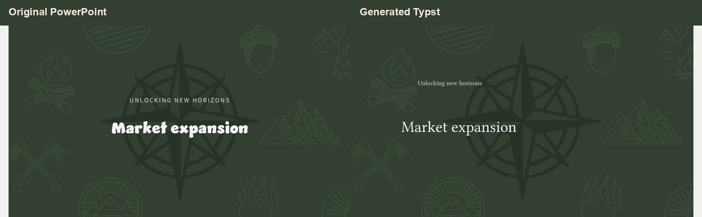

# pptx-typst

`pptx-typst` converts PowerPoint presentations (`.pptx`) to editable Typst source and converts a bounded Typst presentation subset back to PowerPoint.

Version 0.1.0 packages the existing proof of concept. The forward converter supports common text, image, shape, table, layout, and transparency cases. Tables preserve cell text, dimensions, alignment, fills, and common borders; merged cells remain unsupported. SmartArt with a stored PowerPoint drawing cache is included as vector artwork; its text is rendered in the SVG rather than emitted as independently editable Typst text. The converters preserve reusable PowerPoint masters and layouts through explicit `PptxMaster`, `PptxLayout`, and `PptxSlide` declarations. The reverse converter also accepts legacy `#Root` / `#Place` projects, including basic rectangular tables; it does not interpret arbitrary Typst. Font metrics, line wrapping, charts, complex masks, and grouped editability can differ from the source.

## Example

The comparison below shows slide 5 rendered from the original PowerPoint and from the generated Typst project. The artwork and palette carry across, while text styling and placement remain approximate.



## Install

Python 3.10 or newer is required.

This project has not yet been published to PyPI. From a local clone, install it with:

```console
python -m pip install .
```

The forward converter can produce Typst source without the Typst compiler. To render the output as PDF, install the [Typst CLI](https://typst.app/) separately. It keeps the PowerPoint text point sizes and text-frame coordinates, resolves inherited text and bullet styles by default, and preserves bullet hanging indents. It tries the requested font followed by Typst's bundled Libertinus Serif. If the requested font is unavailable, fallback glyph metrics can still change wrapping and line appearance.

## Convert PowerPoint to Typst

```console
pptx-to-typst presentation.pptx --output presentation-typst
```

This creates `main.typ`, `template.typ`, `asset_manifest.json`, and a shared `assets/media/` directory. Compile the result with:

```console
typst compile presentation-typst/main.typ presentation.pdf
```

Mask and text handling options remain available. Run `pptx-to-typst --help` to see them.
Use `--layout-mode flat` to keep the legacy output that repeats inherited master/layout artwork inside each slide.

## Convert Typst to PowerPoint

```console
typst-to-pptx presentation-typst/main.typ --output presentation-roundtrip.pptx
```

The converter writes `conversion_report.json` next to the `.pptx` output. It reports constructs outside the supported subset.

## Start a Typst presentation

Create a starter project with a supported `main.typ` and helper module:

```console
pptx-typst init my-deck
typst compile my-deck/main.typ my-deck/preview.pdf
typst-to-pptx my-deck/main.typ --output my-deck.pptx
```

The initialized deck contains three editable example slides using one shared master and three layouts (cover, story, and insights). Original translucent SVG overlays are installed in `my-deck/assets/` and reused through the hierarchy. Sample copy, quote, and metrics are illustrative placeholders.

To generate just the reusable module, run `pptx-typst module --output pptx-typst.typ`. Import it with `#import "pptx-typst.typ": *`. The module provides `PptxMaster` and `PptxLayout` for shared artwork and `PptxSlide` for slide content, plus `PptxPlace`, `PptxGroup`, `PptxClip`, `PptxBox`, `PptxText`, `PptxImage`, `PptxRect`, `PptxEllipse`, `PptxLine`, and `PptxTable` helpers.

Define each master and its layouts once, then reference a layout from every `PptxSlide`. Shared objects stay in the corresponding PowerPoint master/layout parts. Title, centered-title, and body placeholders can be declared on those layouts and populated with slide-specific text; see the [placeholder support report](docs/placeholder-support.md) for the API, validation, and limitations. Projects without these declarations continue to use the legacy `Root` / `Place` pattern. The reverse converter recognizes only the statically resolvable supported subset; it does not evaluate arbitrary Typst macros or compile-time code. The [master/layout report](docs/master-layout-poc.md) documents the shared artwork architecture and its validation results.

## Python API

The reverse conversion function is available as `pptx_typst.typst_to_pptx`:

```python
from pptx_typst import typst_to_pptx

report = typst_to_pptx("presentation-typst/main.typ", "presentation.pptx")
```

## Development build

```console
python -m pip install -e ".[test]"
pytest
python -m pip install --upgrade build
python -m build
```

The source distribution and wheel are written to `dist/`. The full converted sample under `examples/quarterly_marketing_meeting/` stays in the repository; its media assets are excluded from package distributions. The smaller README comparison image is included in the source distribution.

Development-only visual and geometry utilities live under `tools/`.

## Project status

This is an alpha proof of concept. Review conversion reports and visually inspect presentations before relying on converted output. The project does not claim pixel-perfect rendering or support for arbitrary Typst source.

Master/layout reuse is implemented for the documented static subset. See the [master/layout support report](docs/master-layout-poc.md) for architecture, results, and current limits.

The v0.1.0 stabilization run converted and rendered all 100 presentations in the frozen benchmark corpus. EMF/WMF fallback behavior, unsupported-object reporting, benchmark methods, and the productization decision are documented in the [stabilization report](docs/alpha-stabilization-report.md). This corpus result is evidence for continued experimental use, not a guarantee for arbitrary decks or every platform.

## License

Licensed under the [Apache License, Version 2.0](LICENSE).
