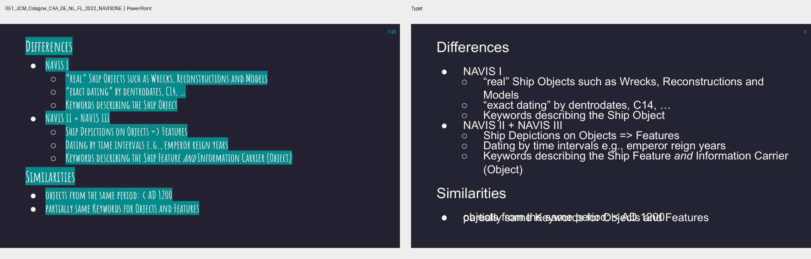

# Text placement fidelity investigation

## Result

**PARTIAL.** The old 46.14 pt mean start error is not a reliable measure of text-box geometry: its greedy PDF text-block matcher used text similarity alone, so similar or fragmented text could be paired across unrelated positions. A source-object and spatially constrained audit found that outer text-frame geometry is preserved essentially exactly. It also confirmed a paragraph-advance bug that caused large vertical overflow in one representative deck. The focused correction reduced that overflow without changing the measured first-glyph position, but it did not eliminate all text collisions or renderer-dependent wrapping.

This was a three-deck representative sample, not a rerun of the 100-deck corpus. The corpus baseline remains 78/100 successful conversions, 87.7% layout fidelity, 42.3% text fidelity, 39.2% ink-edge F1, 46.9% start-position accuracy, 46.14 pt historical mean start error, and 73.1% wrap-line match. The 22 unsupported-media compile failures are outside this task.

## Root causes

- **PDF matching inflated/obscured displacement.** Historical matching greedily selected text blocks at similarity ≥0.6 with no spatial constraint. PDF extraction merges and fragments blocks; repeated titles and labels can consequently produce incorrect displacement pairs. The old score remains unchanged for historical comparison, but is no longer treated as a structural-position measurement.
- **Outer geometry is not the general cause.** In three font-supported sample decks, all 332 source text objects joined to converter placements by slide and PowerPoint shape ID. Content previews matched for all 332. Maximum absolute error across x, y, width, height, and rotation was below 0.005 pt. This also covers seven grouped text objects.
- **Paragraph advance caused confirmed overflow.** The prior default inserted a full baseline-sized vertical gap after every paragraph. In NAVIS slide 21 this produced a 31.69 pt mean baseline pitch against PowerPoint's 26.42 pt, with 66.10 pt of text overflowing the frame. Using no gap caused adjacent Typst paragraph blocks to collide. The default now inserts 20% of the line pitch as a paragraph advance; the legacy full-gap mode remains selectable with `--text-layout anchors`.
- **Remaining rendered differences are mainly typography and paragraph structure.** The font gate confirms the resolved family is installed, but does not guarantee identical font resolution or glyph metrics in both renderers. The sample includes substantially wider Typst text, extra wrapped lines, and source bullets/paragraphs whose layout is not reproduced exactly. The corpus mean PDF font-size difference is only 1.10 pt, while ink-edge F1 is 39.2%, consistent with glyph appearance and metrics contributing more than nominal size alone. Wrap count remains diagnostic and is not scored as text placement.

## Measurement method

The existing corpus scores are retained. `tools/analyze_text_placement.py` adds a diagnostic split:

1. **Structural:** match source text shapes to generated manifest objects by slide and source shape ID; compare x/y/width/height/rotation and source text preservation. No rendered glyph pixels enter this measure.
2. **Rendered position:** match extracted PDF spans to source objects using text evidence plus frame intersection/distance. Report first-glyph displacement, baseline delta, glyph bounds, line pitch, frame overflow, ambiguous spans, missing objects, and unassigned spans. Ties and numeric/page-number fragments are not silently counted as accurate matches.
3. **Typography:** report font-gated eligibility separately from font size, ink appearance, and line wrapping. These values are not folded into structural geometry.

The new spatial block matcher is also reported beside the historical greedy matcher. Neither alone is treated as definitive where PDF spans cannot be assigned confidently. The analyzer requires Windows PowerPoint and Typst and can be rerun on a small sample using the command in the benchmark README.

## Before and after

The rendered-position sample contained 153 confidently object-linked text objects across 72 font-supported text slides. The risk deck contributed one eligible object, NAVIS 12, and Radio Imaging 140, so the aggregate is weighted heavily toward Radio Imaging and is not a corpus estimate.

| Diagnostic | Prior default | Focused default | Interpretation |
|---|---:|---:|---|
| Object-linked starts within 12 pt | 91.5% (140/153) | 91.5% (140/153) | No material position-score change |
| Mean first-glyph displacement | 9.25 pt | 9.24 pt | Essentially unchanged; not comparable to historical 46.14 pt block metric |
| NAVIS mean overflow beyond frame | 17.25 pt | 8.50 pt | 50.7% lower in this sample |
| NAVIS slide 21 text overflow | 66.10 pt | 22.54 pt | Reduced by 43.56 pt; still exceeds source's 6.95 pt |
| NAVIS slide 21 mean baseline pitch | 31.69 pt | 23.56 pt | Moved closer to source's 26.42 pt |
| NAVIS matched-block wrap-count rate | 75.0% | 53.3% | Worsened; wrapping is renderer-dependent and excluded from the position score |
| Radio Imaging mean overflow | 1.76 pt | 0.71 pt | Small improvement; non-text placements were not changed |

The start-position results show why the old low score should not be read as a 46 pt systematic text-frame offset. In the sample, 91.5% of confidently linked glyph starts are within the proposed 12 pt tolerance. Four source/output spans were marked ambiguous; additional PDF spans remained unassigned and are excluded rather than scored as correct. The small sample also contains genuine horizontal start shifts where centered text has different glyph widths.

The NAVIS visual pair below compares the same PowerPoint-exported slide 21 with the old and focused paragraph advance. It shows less accumulated vertical overflow after the change, while also making the remaining line-wrap and crowded lower bullets visible.

The source deck is “NAVIS.one: Challenges and Opportunities for RSE and RDM by designing a common web application from a 1990s online database,” by Florian Thiery and Allard Mees ([Zenodo record 7142171](https://doi.org/10.5281/zenodo.7142171)), licensed CC BY 4.0.

## Verification and limits

- Regression coverage checks that the default emits a reduced paragraph advance, preserves text, and compiles. The test suite also exercises Typst-to-PowerPoint conversion and existing graphical smoke coverage.
- The correction only changes text paragraph advance. No image, shape, crop, or non-text placement conversion code changed. All 332 sampled source text objects retained their geometry and text in the manifest, and non-text placement manifests were identical across the before/after runs for all 542 sampled graphical objects. No graphical layout score was rerun after this text-only change.
- The 100-deck benchmark was not rerun, as required by the bounded stopping rule. Its 22 media-format compile failures remain separate.
- Remaining differences include font resolution/rendering, bullet and paragraph structure, line wrapping, and some real text overflow. Resolving these across arbitrary PowerPoint text layouts would require substantially broader text-engine work than this focused correction.

Further development is recommended only if representative user decks show the residual overflow or bullet collisions as a practical blocker. The current evidence does not justify optimizing the corpus ink-edge score.
