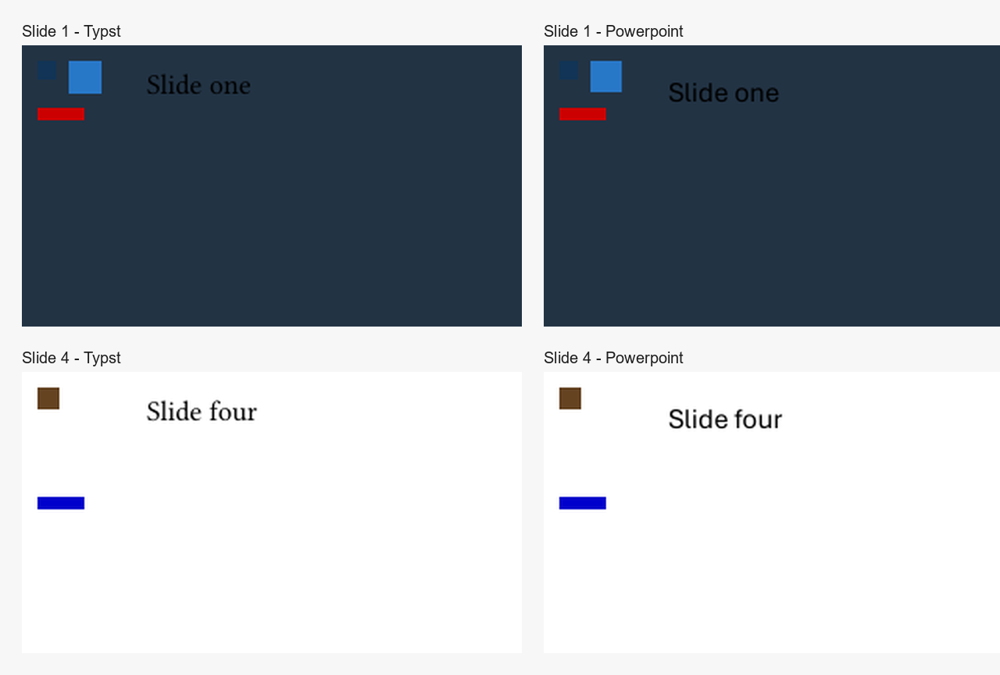

# PowerPoint master and layout support

The converter now preserves the supported PowerPoint `Master -> Layout -> Slide` hierarchy in both directions. The implementation uses explicit Typst declarations and creates actual editable PresentationML master, layout, and slide parts. It remains a bounded static-object subset, not a general Typst interpreter or a full PowerPoint renderer.

## Typst representation

```typst
#let brand = PptxMaster(fill: rgb("#112233"), children: [
  #Place(x: 24pt, y: 24pt, child: image("assets/logo.png", width: 48pt, height: 48pt))
])

#let title-layout = PptxLayout(master: brand, children: [
  #Place(x: 90pt, y: 24pt, child: rect(width: 200pt, height: 4pt, fill: rgb("#DD8047")))
])

#PptxSlide(layout: title-layout, children: [
  #Place(x: 90pt, y: 60pt, child: text(size: 28pt)[Quarterly review])
])
```

`PptxMaster` and `PptxLayout` hold reusable content and backgrounds. A background image can be declared once with `background: image("assets/brand-background.jpg", width: 960pt, height: 540pt, fit: "stretch")`; slide-level fills override inherited master backgrounds. `PptxSlide` composes the background, master content, layout content, then slide content. The shared template supports inherited fills, background images, and the `show-master` flag. Legacy `Root` and `Place` projects still convert without hierarchy declarations. PPTX-to-Typst also provides `--layout-mode flat` as a compatibility option that repeats inherited artwork as before.

## Validation results

### Synthetic shared and multiple-master fixture

The automated fixture contains four slides, two masters, three layouts, one master image, distinct master/layout artwork, and two slides sharing the same layout. It validates both conversion directions and reads the OOXML package relationships directly.

- Reverse output contains four slide parts, two master parts, and three custom layout parts. The two slides assigned to `Alpha` reference the same layout part.
- Slide parts contain only their individual slide-owned text boxes. Shared shapes and the image live in their master/layout parts.
- The package contains independent theme parts and relationships for the two masters, scoped image relationships, and matching master -> layout -> slide references. `python-pptx` reopens the package.
- Forward conversion recovers two master and three layout declarations. Typst compiles to four pages. Extracted text contains no stray comma glyphs.

### Quarterly marketing deck

The 13-slide local sample uses one master and 13 layouts, each used by one slide. Its source master contains five placeholders and no non-placeholder artwork. The layouts have 66 non-placeholder placements; the slides have 39 slide-owned placements.

- Structured and legacy-flat Typst both compile to 13 pages. At 960 x 540 pixels, all 13 corresponding page renders are pixel-identical in the same Typst environment.
- Reverse conversion produces 13 slides, one master, exactly 13 custom layouts, and 13 slide-to-layout assignments. The 11 unused starter layouts are removed from the generated package.
- The reverse converter reports 8 unsupported empty-box constructs (43.26 x 28.75 pt); the remaining 97 supported objects are represented in the deck. These are existing subset limitations, not silently discarded support claims.

The quarterly sample does not demonstrate shared-layout reuse because every slide uses a different layout; the synthetic fixture covers that case.



## Feature status

**Supported:** Source-part ownership and references; multiple masters; multiple layouts per master; slide layout assignment; shared image relationships; solid RGB and image backgrounds; editable supported text, shapes, lines, pictures, and tables; master/layout/slide stacking; static master visibility flags; compatibility with existing `Root`/`Place` projects.

**Partially supported:** The forward converter resolves theme background references through the theme fill-style list, including solid, gradient, and image fills. Slide color-map overrides remain slide-specific. Solid and image backgrounds round-trip; gradient backgrounds are reported by reverse conversion and are not recreated as gradients. Theme editing is not modeled as a complete PowerPoint theme editor. Native title and body placeholder support has since been added for a bounded subset; see [placeholder support](placeholder-support.md) for its behavior and limitations. Shapes the forward converter materializes as SVGs remain picture objects when converted back. Unsupported reverse constructs appear in `conversion_report.json`.

**Unsupported:** Placeholder types and dynamic behaviors outside the subset documented in [placeholder support](placeholder-support.md), animations and transitions, arbitrary Typst evaluation, non-static advanced visibility behavior, and exact font rendering.

Desktop validation: the synthetic package passed XML relationship checks, reopened in `python-pptx`, and opened and rendered as a four-page PDF in desktop PowerPoint. Editing a master shape in PowerPoint changed slides 1-3 only; editing the `Alpha` layout shape changed slides 1-2 only. Pixel diffs showed 384 changed pixels on slides 1-2, 144 on slide 3, and 0 on slide 4, matching the master/layout assignments. Visual inspection confirmed the shared master image and master/layout shapes were inherited in the expected order.

## Implementation notes

The forward converter keys declarations by the source master/layout part URI, not shape similarity. The reverse resolver accepts only named `PptxMaster`, `PptxLayout`, and `PptxSlide` declarations with statically resolvable references. It stages supported shapes through the existing shape exporter, moves those editable shape trees into actual OOXML owner parts, scopes media relationships to those parts, registers each layout on exactly one master, then removes the staging slides.
