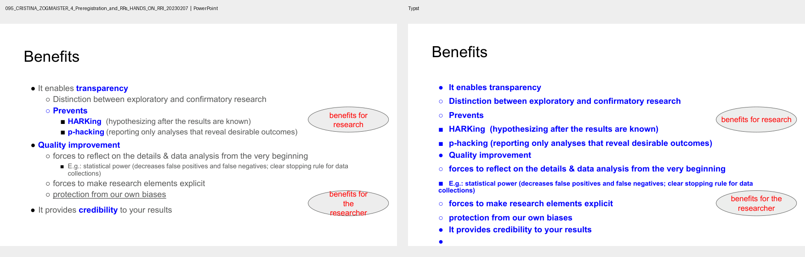
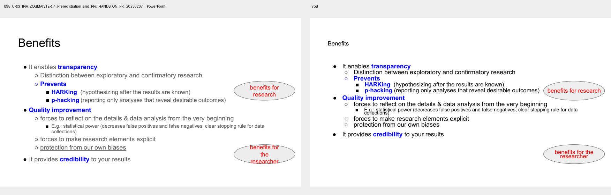

# Paragraph layout fidelity

## Result

**PARTIAL.** Ordinary text frames and title/body placeholders now use one paragraph record and one Typst renderer. Controlled fixtures preserve spacing semantics, paragraph boundaries, soft breaks, list levels, autofit metadata, and native placeholder ownership through a round trip. Font metrics and PowerPoint/Typst line-box differences still produce visible pitch and wrapping differences in real decks.

## What changed

Previously, ordinary text frames converted DrawingML line spacing to Typst leading with a fixed formula based on `0.52em` and `0.67em`, then inserted a manual paragraph advance. The placeholder path had separate paragraph rendering and did not preserve all line-spacing and before/after values. Paragraph inheritance was read from a few selected XML nodes instead of resolving each property independently.

`src/pptx_typst/paragraph_layout.py` now models line spacing as either a percentage or point value, plus paragraph before/after spacing, alignment, indentation, bullet properties, and the source that supplied each value. Resolution walks direct paragraph properties, shape list styles, matching layout and master placeholders, and master text styles. Each property resolves separately, so an explicit alignment does not mask inherited line spacing.

The Typst API serializes that same record as `PptxParagraph` for ordinary text and `PptxPlaceholderParagraph` for native placeholders. Both are rendered through `PptxTextFrame`. The record retains source values and origins for reverse conversion; inherited placeholder paragraph properties are written to the corresponding layout/master part while direct slide overrides remain local. Bullet marker font, size, and color now travel with the record to avoid marker-metric changes shifting equivalent text frames.

## Spacing translation

PowerPoint's `a:spcPct` describes a target baseline pitch as a percentage of the font size; `a:spcPts` describes a pitch in points. Typst's `leading` is additional distance between line boxes. The current deterministic fallback treats the font's natural pitch as 1em, then computes:

```text
Typst leading = effective PowerPoint pitch - nominal font size
```

For autofit line-spacing reduction, the source pitch is reduced before calculating Typst leading. Explicit before/after values are translated independently. Unspecified spacing stays unspecified, except autofit reduction is reflected as a relative reduction against the same nominal natural-pitch fallback.

This preserves the source spacing kind and value but cannot reproduce each font engine's actual ascent, descent, line gap, or mixed-run metrics. No font-specific coefficients or per-deck corrections are used. Percentage spacing is not converted into an arbitrary paragraph gap.

## Validation

The synthetic fixture contains equivalent ordinary and body-placeholder frames at the same geometry and vertical anchor. It exercises 100%, 120%, 150%, 80%, and point-based spacing; explicit before/after spacing; inherited layout spacing and a slide override; master-placeholder spacing; two bullet levels; explicit bullet font/size/color; mixed run sizes; a soft break; an empty paragraph; autofit; and top anchoring. The generated Typst compiles. PDF span origins for the same text in the text box and placeholder agree within 0.01 pt. Reverse conversion keeps native placeholders and round-trips the tested DrawingML values. All 43 tests pass.

The text-placement analyzer now maps exported PowerPoint PDF pages to their visible source slides by deterministic slide order, excluding hidden slides. A page-count or Typst-count disagreement marks the comparison invalid and excludes it. Six representative decks had matching source/Typst page counts (54/54, 11/11, 11/11, 8/8, 23/23, and 35/35); none had hidden slides. This measurement does not rely on text similarity to establish slide identity.

Object-linked rendered diagnostics after the change:

| Deck | Font-supported text slides | Objects with glyphs in both PDFs | Line-pitch objects / intervals compared | Mean absolute pitch delta | Line-count mismatch objects |
|---|---:|---:|---:|---:|---:|
| NAVIS.one | 10 / 54 | 0 | 0 / 0 | Not measurable | 0 |
| State of Astropy | 11 / 11 | 5 | 1 / 1 | 10.0 pt | 0 |
| BMH Summit | 11 / 11 | 12 | 9 / 62 | 8.0 pt | 3 |
| Depression cues | 8 / 8 | 10 | 6 / 11 | 24.7 pt | 1 |
| Preregistration / RRI | 22 / 22 | 74 | 33 / 78 | 6.9 pt | 1 |
| Open Science ETDs | 32 / 32 | 23 | 10 / 29 | 5.8 pt | 2 |

Pitch is compared only for confidently object-linked text whose rendered line counts match. The State of Astropy estimate is based on one object; Depression cues contains a material pitch outlier; the metrics therefore do not support a general claim that real-world pitch accuracy improved. NAVIS produced no object-linked glyph matches, so its requested slide 21 is not scored. Text-start matches also remain affected by list hierarchy and line wrapping. Frame-overflow counts above 2 pt were 0 Typst objects in NAVIS, Astropy, BMH, and Depression cues; 0 versus 1 source object in RRI; and 1 source / 1 Typst object in Open Science ETDs.

The old `anchors` mode and the new shared renderer are shown for RRI slide 6. The old image comes from the pre-change `a5c1997` implementation; the new image uses the current default. It is a visual comparison, not an isolated pixel experiment: the former path also had different run-style inheritance. It shows the full-line paragraph advance and overly bold text from the old path, while the shared renderer keeps mixed regular/bold/italic runs and avoids that extra gap.

**Before (`--text-layout anchors`):**



**After (shared paragraph renderer):**



The prior `anchors-spacing` measurement on the same RRI deck had a 1.95 pt mean line-spacing delta on text-only matches; the current object-linked method reports 6.88 pt on 33 objects and 78 intervals. These values use different match populations and cannot establish a measured regression or improvement. No aggregate text score is used as an acceptance target.

## Remaining limitations

- The 1em natural-pitch fallback is deterministic, not a font-metric reproduction. Correct pitch may require reading the exact selected font's metrics and reproducing each renderer's baseline model.
- Mixed-size runs affect the font line box and may cause different wrapping even when source geometry and point size are retained.
- Numbered bullets and theme-derived bullet styling are represented for the current supported subset; full Office list-style cascade, tab-stop behavior, and dynamic placeholder insertion are not implemented.
- Real-world diagnostic matching still leaves many text spans unmatched, and dense/repeated text may remain uncertain. Ambiguous page correspondence is excluded; uncertain text matches are reported and do not enter the line-pitch statistic.
- Desktop PowerPoint behavioral comparison was unavailable for these sampled decks during this milestone. Source OOXML and the installed Typst renderer were inspected, and reverse conversion was structurally checked.

## Files and tests

- Shared model: `src/pptx_typst/paragraph_layout.py`
- PPTX import and Typst generation: `src/pptx_typst/pptx_to_typst.py`
- Shared Typst renderer: `src/pptx_typst/template.typ` and `src/pptx_typst/templates/pptx-typst.typ`
- Editable PPTX writing: `src/pptx_typst/typst_to_pptx.py`
- Controlled regression: `tests/test_paragraph_layout.py`
- Page alignment and rendered metrics: `tools/analyze_text_placement.py`
