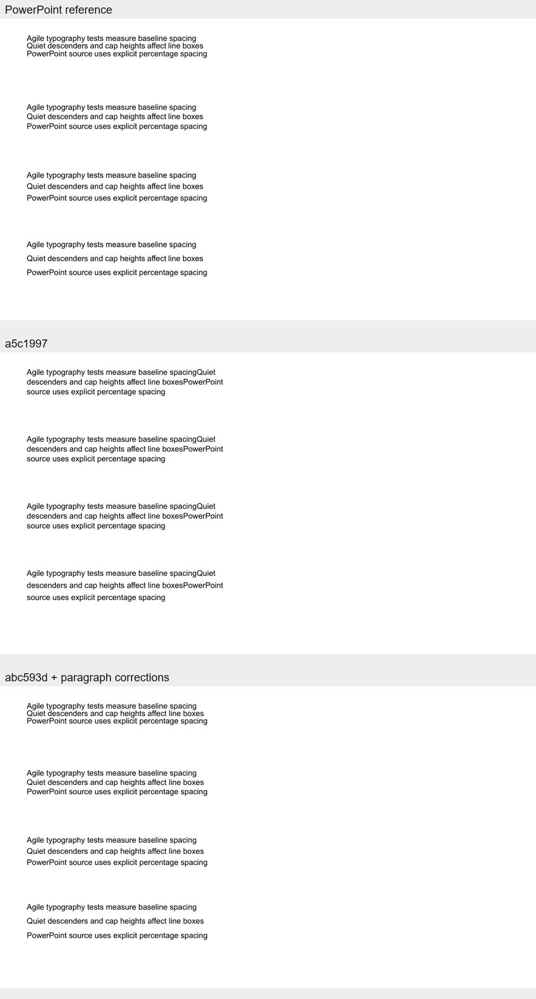
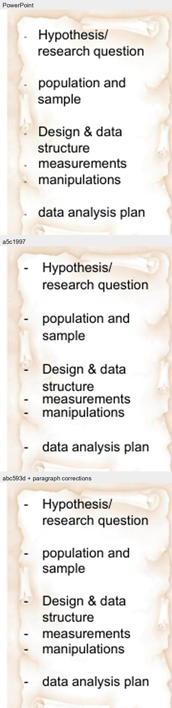
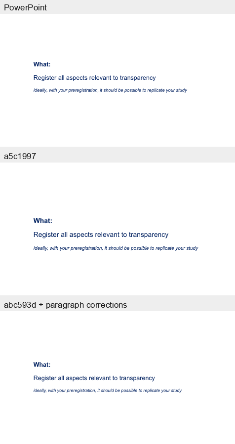

# Paragraph layout fidelity review

## Decision

**PARTIAL.** The renderer now maps supported PowerPoint spacing to measured Typst font metrics consistently, and the RRI empty-paragraph defect is corrected. Controlled pitch error is below 0.4 pt. Real-deck wrapping, text matching, and font/layout inheritance differences remain; no general typography-engine work is justified by this sample.

## What changed

The previous translation treated Typst's natural line pitch as exactly `1em`, then used `target pitch − font size` as Typst leading. That is the wrong quantity: Typst leading is the gap from the previous line box's bottom edge to the next line box's top edge. With the default cap-height/baseline edges, the font's measured cap height is part of baseline advance. Typst documents these semantics in its [paragraph reference](https://typst.app/docs/reference/model/par/) and [text reference](https://typst.app/docs/reference/text/text/).

`paragraph_layout.py` now preserves the PowerPoint spacing kind/value and computes a target pitch separately from rendering. In a controlled PowerPoint-exported Arial 14 pt fixture, percentage spacing produced baseline pitches of 13.44, 16.80, 20.16, and 25.20 pt at 80%, 100%, 120%, and 150%. The renderer measures the selected Typst font's cap-height in context and sets leading to `target pitch − measured cap-height`. Point-based spacing stays in points. Unspecified single spacing uses the measured 1.2-em baseline pitch, and `normAutofit` line reduction is applied to that target before Typst leading is calculated.

The same `PptxTextFrame` path handles ordinary text and native placeholders. Two additional real-world errors were confirmed and corrected:

- Empty DrawingML paragraphs can carry an `endParaRPr` caret size and bullet style even though PowerPoint renders only blank vertical space. Their line box now uses the nearest visible paragraph's font size/family; the empty line does not draw a bullet. This prevents a 20 pt caret style from replacing a 14 pt line pitch.
- A soft line break has no text run of its own. It now carries the preceding run's style so an unstyled break does not inherit the different outer font size of a placeholder versus an ordinary text frame.

The renderer still retains explicit paragraph before/after spacing and source `spcPct`/`spcPts` data for reverse conversion. The `Root`, `Place`, `PptxSlide`, and native placeholder structures are unchanged.

## Measurement method

The `a5c1997` and `abc593d` revisions were converted and rendered with the same diagnostic code, identical input PPTX files, the same PowerPoint PDF export, Typst `0.15.1`, installed fonts, 1.2 render scale, and source-order page map. All six decks had matching source and Typst page counts and no hidden slides, so each scored page maps to the same source slide by identity and order rather than text similarity.

The analyzer reports object-linked first-glyph/paragraph starts separately from baseline pitch. Pitch enters the statistics only where source and output line segmentation is identical; paragraph gaps are excluded from pitch. The table shows every counted interval/object and matched text-object count. Unassigned PDF spans are reported rather than treated as successful matches. The historical greedy/text-similarity metrics are not used here.

The sample is limited and not a population benchmark. Font support means the source text-slide fonts were present in Typst's installed font list. NAVIS had no object-linked glyph pairs, so it contributes no spacing measurement.

## Same-method real-deck comparison

Values are mean / median absolute error in points. “Starts” are paragraph-start baseline displacement for structurally matched text objects, not line pitch.

| Deck | Font-supported text slides | Object matches, old → new | Pitch intervals, old → new | Pitch error, old → new | Paragraph starts, old → new | Line-count mismatch objects, old → new | Typst overflow objects >2 pt, old → new |
|---|---:|---:|---:|---:|---:|---:|---:|
| Depression Cues | 8 / 8 | 10 → 10 | 4 → 4 | 5.47 / 7.12 → 0.01 / 0.00 | 30.91 / 20.72 → 17.20 / 20.07 | 1 → 1 | 0 → 1 |
| BMH Summit | 11 / 11 | 11 → 12 | 19 → 24 | 0.93 / 1.11 → 1.49 / 1.74 | 11.50 / 7.33 → 12.44 / 4.33 | 2 → 3 | 1 → 2 |
| State of Astropy | 11 / 11 | 5 → 5 | 0 → 0 | Not measurable | 4.99 / 3.56 → 4.07 / 3.56 | 0 → 0 | 0 → 0 |
| Preregistration / RRI | 22 / 22 | 74 → 74 | 38 → 38 | 0.53 / 0.50 → 0.01 / 0.00 | 4.58 / 2.13 → 2.49 / 2.30 | 1 → 1 | 1 → 1 |
| Open Science ETDs | 32 / 32 | 23 → 23 | 8 → 8 | 1.07 / 0.85 → 0.00 / 0.00 | 6.44 / 3.57 → 3.55 / 3.16 | 7 → 8 | 4 → 4 |
| NAVIS.one | 10 / 54 | 0 → 0 | 0 → 0 | Not measurable | Not measurable | 0 → 0 | 0 → 0 |

The BMH pitch sample is a small exception: its mean and median pitch deltas increased by about 0.6 pt, while paragraph-start median improved. That difference is small relative to the sample's wrapping and list-matching variation; it does not support a deck-specific correction. In ETDs, pitch and paragraph starts improved while one additional object had a line-count mismatch. The aggregate overflow count stayed at four. These wrap differences are reported separately from pitch.

### Reconsidering the earlier outliers

The former 24.7 pt Depression Cues “pitch” outlier combined paragraph-start gaps with line pitch. With paragraph boundaries excluded, the same-method old converter has four comparable intervals at 5.47 pt mean error; the current renderer has four at 0.01 pt. For the multi-paragraph object on slide 4, mean paragraph-start displacement falls from 34.19 to 19.52 pt, with no line-count difference. Residual start displacement includes initial anchor and glyph metrics, not a line-pitch defect.

The 8 pt BMH figure also came from an earlier matching population. Under the fixed matcher, its old sample is 19 intervals at 0.93 pt mean error, and the new sample is 24 intervals at 1.49 pt. Wrapping, bullets, and a changed matched-object population explain more of the visual difference than pitch alone. This is not a confirmed spacing regression requiring another targeted patch.

Astropy's selected slides contain no reliable multi-line baseline pairs, and NAVIS has no object-linked glyph matches. Those cases cannot establish line-pitch fidelity. RRI slide 2 is a useful control for empty paragraphs: the nine visible source baselines and current output baselines have a 3.61 pt mean paragraph-start offset, no line-count difference, and no frame overflow. Its residual is a near-uniform starting offset.

## Controlled fixture

The Arial 14 pt fixture contains equivalent ordinary text frames at 80%, 100%, 120%, and 150% spacing with three soft-break lines. The updated renderer matches the PowerPoint baseline pitch with eight comparable intervals: **0.073 pt mean absolute error, 0.025 pt median, and 0.36 pt maximum**. The old output had no line intervals accepted by the stricter line-segmentation matcher, so no comparable old numeric pitch is claimed. Its rendered sheet remains available for visual inspection.

## Visual comparisons

The images show the PowerPoint PDF render, `a5c1997`, and the corrected `abc593d`-based renderer at identical slide size. They are visual checks, not additional scores. Some unrelated placeholder font sizing, glyph substitution, and overall object differences remain visible and are not attributed to line spacing.

**Depression Cues, slide 4.** This multi-paragraph object exposed the former false pitch outlier. The baseline advances now match when line segmentation agrees; paragraph-start displacement remains visible.

Source deck: Urška Smrke et al., [Zenodo record 7300056](https://doi.org/10.5281/zenodo.7300056), CC BY 4.0.

**Preregistration / RRI, slide 2.** The blank list paragraphs used a 20 pt caret bullet style in OOXML although PowerPoint rendered no bullet there. The corrected Typst output keeps those blank lines at the neighboring text pitch and removes the stray markers.

**Preregistration / RRI, slide 10.** Paragraph starts and mixed regular/italic text remain close; the smaller remaining displacement is mainly the initial anchor.

Source deck: Sara Casati et al., [Zenodo record 7646077](https://doi.org/10.5281/zenodo.7646077), CC BY 4.0.

## Validation and limitations

- `python -m pytest -q`: **45 passed**, including the focused empty-paragraph and styled-soft-break regressions.
- The synthetic conversion compiles in Typst and its ordinary text frame and native placeholder produce matching positions for the first line and a following paragraph. Round-trip assertions retain percentage/point spacing, before/after values, soft breaks, bullets, and native placeholder parts.
- Non-text geometry is unchanged by the renderer patch. Structural geometry deltas in the fixed sample remain below 0.005 pt; edits affect text serialization/rendering only.
- The six-deck sample preserves page counts and source ordering. It is not a full 100-deck benchmark rerun.

Remaining differences include font-specific ascent/descent/line-gap behavior between PowerPoint and Typst, mixed-size runs that alter line boxes, autofit nuances, wrap changes, bullet indentation, and many unmatched PDF spans. The current line-height model measures Typst's selected font but does not reproduce PowerPoint's font shaping or paragraph engine. No custom shaping or per-font calibration is warranted for this PoC milestone.

## Evidence files

- Shared paragraph model: `src/pptx_typst/paragraph_layout.py`
- PPTX paragraph extraction: `src/pptx_typst/pptx_to_typst.py`
- Shared Typst renderer: `src/pptx_typst/template.typ` and `src/pptx_typst/templates/pptx-typst.typ`
- Controlled and real-deck measurements: ignored local files under `benchmarks/text_fidelity/work/paragraph-spacing-validation/`
- Regression tests: `tests/test_paragraph_layout.py`
- Diagnostic code: `src/pptx_typst/text_diagnostics.py` and `tools/analyze_text_placement.py`
