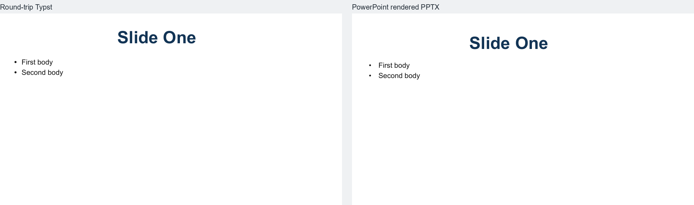

# Native title and body placeholders

The structured PPTX ↔ Typst path now preserves native PowerPoint title, centered-title, and body placeholder relationships. A layout owns reusable placeholder slots; each slide stores its own placeholder instance and text. The reverse converter writes these as PresentationML `p:sp` elements with matching `p:ph` type and `idx` attributes instead of ordinary text boxes.

## Typst authoring model

Declare slots on the existing master and layout objects, then provide slide-local content by matching `id`:

```typst
#let Brand = PptxMaster(placeholders: (
  PptxPlaceholderSlot(
    id: "title-0", type: "title", idx: 0,
    font: "Arial", size: 36pt, fill: rgb("#24343B"), weight: "bold",
  ),
))

#let Content = PptxLayout(master: Brand, placeholders: (
  PptxPlaceholderSlot(
    id: "title-0", type: "title", idx: 0,
    x: 40pt, y: 50pt, width: 800pt, height: 60pt,
  ),
  PptxPlaceholderSlot(
    id: "body-1", type: "body", idx: 1,
    x: 40pt, y: 130pt, width: 800pt, height: 320pt, bullet: "•",
  ),
))

#PptxSlide(layout: Content, placeholders: (
  PptxPlaceholder(id: "title-0", type: "title", idx: 0, text: "Quarterly review"),
  PptxPlaceholder(id: "body-1", type: "body", idx: 1, text: "Performance\nOutlook"),
))
```

Slot fields resolve slide instance → layout → master. Only explicitly supplied slide properties are written as slide-level overrides. The forward converter also preserves per-paragraph text, level, direct alignment, and direct character bullets where found. Title placeholders default to centered alignment for Typst rendering when no alignment is specified; body placeholders default to left alignment. Existing `Root`, `Place`, and slides without placeholder declarations remain supported.

PPTX import recognizes title, centered-title, and body placeholders. Unsupported placeholder kinds retain the legacy ordinary-object fallback on slides and are not declared as native supported slots; unsupported master/layout slots and unresolved slide slots are recorded in `asset_manifest.json`. The manifest records supported placeholder owner, ID, type, index, source shape, layout reference, text, and direct geometry overrides.

## Validation

Automated regression coverage uses a synthetic one-master, two-layout, four-slide deck. Three slides share one layout; the fourth uses the other layout. It checks that the package contains native placeholder elements, the correct type/index pairs, layout-to-slide relationships, local title-size override, omitted slide transforms for inherited geometry, editable text, and no duplicate ordinary slide text boxes. The round-trip Typst compiles and retains all eight placeholder instances. The full test suite passes (`23 passed`).

Desktop PowerPoint opened and rendered the generated package. Moving and resizing the shared layout title placeholder changed its three slides; the other layout remained unchanged. A 54 pt layout title size was inherited by slides without overrides, while the explicit 48 pt slide override remained. Editing slide 1's title did not change slide 2. Saving and reopening retained four slides and the independent text. The comparison below shows the round-trip Typst and PowerPoint render; both retain the shared placeholder layout and text styling, with expected renderer-specific glyph metrics and ink offsets.



The desktop test did not exercise PowerPoint's Reset/Reapply Layout UI command. The generated slides omit local geometry where it is inherited, and PowerPoint's reset command was unavailable through the automation interface used here; reset behavior should therefore be verified manually before relying on it in production workflows.

## Supported and remaining limitations

**Supported:** Native `title`, `ctrTitle`, and `body` placeholder part relationships; stable `type`/`idx` linkage; multiple masters/layouts using the existing hierarchy writer; layout-owned geometry and supported basic text styles; slide-local editable text and explicit geometry/size/style overrides; simple paragraphs, levels, and direct character bullets; Unicode text; conversion manifest provenance.

**Partial:** Inheritance is static and bounded to fields represented by the Typst slot API (geometry, rotation, font, size, fill, weight, alignment, anchor, margins, and basic bullet marker). Some PowerPoint text styling is not captured, including complete paragraph spacing, theme font resolution, line spacing, rich runs, all bullet numbering/indentation, and master `txStyles` levels beyond the supported first paragraph level. Grouped/transformed placeholders and ambiguous or missing `p:ph` metadata use existing fallback behavior. PowerPoint Reset/Reapply Layout was not behaviorally verified.

**Unsupported:** Picture, chart, table, media, date/time, footer, and slide-number placeholders; dynamic content insertion; animations; arbitrary Typst evaluation; the complete Office style cascade.

This is a bounded editable placeholder subset, not full PowerPoint placeholder compatibility.
