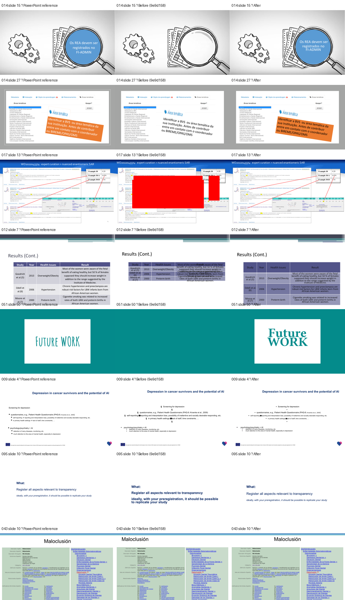
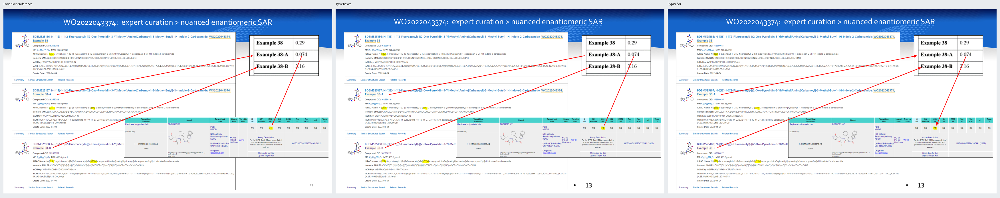

# Visual fidelity regression review

## Outcome

**PARTIAL.** The selected design-damaging defects were reproduced and corrected in the supported converter subset. The full test suite passes, and the updated converter renders the representative decks in both directions. Triangle connector markers are preserved as editable vector artwork in Typst and restored as native PowerPoint markers on reverse conversion; other marker styles, unavailable source fonts, and some renderer-dependent wrapping remain limited.

## Page correspondence

The five page-count mismatches were caused by hidden slides. PowerPoint's PDF export omits hidden slides; the Typst converter intentionally retains every source slide. The benchmark had compared the PDFs by page number, which paired different slides after the first hidden slide.

The hidden source slide indices are:

| Deck | Source PDF pages | Typst pages | Hidden source slides |
|---|---:|---:|---|
| `002_DASH-2023-CH-talk-KMuglach-3oct2023-final` | 6 | 13 | 7–13 |
| `074_S03E03-Anita_Bandrowski_-_IEEE_RO_Slides_2018` | 21 | 23 | 2–3 |
| `077_Slides_Katerina_Zourou_workshop_August_2022` | 20 | 21 | 17 |
| `091_Towards_NL_PID_roadmap_20230221` | 17 | 18 | 6 |
| `096_3_Renzo_Huber_Whatever_works` | 8 | 12 | 7–10 |

The benchmark now reads hidden-slide metadata and maps each PowerPoint PDF page to the same visible source slide in Typst by source order. It accepts a deck only when PowerPoint page count equals the number of visible slides and Typst page count equals the source slide count. Any other count is recorded as `invalid_comparison` and excluded. The corrected benchmark has 89/89 verified converted decks and zero ambiguous comparisons; the 11 conversion/render failures remain separate.

Correcting the five bad page pairings changed the mixed-corpus means from the supplied baseline: layout fidelity 89.9% → 91.0%, text fidelity 47.1% → 48.0%, full-slide fidelity 69.2% → 70.1%, and mean text-start error 46.14 pt → 38.73 pt. These are measurement corrections, not converter improvements. Other deck measurements were retained. Hidden slides are also excluded from source-text eligibility counts.

## Confirmed defects and corrections

| Deck / slide | Category and confirmed cause | Correction and evidence |
|---|---|---|
| 014 / 15 | `missing_object`, `styling`: a circular `flowChartConnector` used a theme `fillRef`; the exporter ignored theme fill styles and the preset geometry was unsupported. | Resolve referenced theme fills and map this fixed preset to a circle. The blue artwork now appears. |
| 014 / 27 | `missing_object`, `styling`: the orange text-box backing was stored as a theme fill reference, not a direct `spPr` fill. | Route text-shape rendering through the same resolved fill path. The orange callout now renders. |
| 017 / 13 | `spurious_object`, `geometry`: SVG rendering of ordinary `straightConnector1` lines produced solid red rectangles; removing SVG arrow markers did not remove the defect. | Emit editable Typst `PptxLine` primitives with source endpoints and stroke. The red rectangles are gone and fine red connectors return. Supported triangle markers are now generated from their source endpoints and remain editable; unsupported marker styles are reported in the manifest. |
| 012 / 7 | `table_layout`: OOXML row heights totaled 116.8 pt while the table frame was 268.18 pt, so fixed Typst rows collapsed within the larger source frame. | Scale row heights proportionally to the source frame height when the stored total is stale. The representative table now occupies its source frame and its text no longer overlaps severely. Cell widths, fills, borders, and insets continue through the existing table path. |
| 051 / 50 | `missing_object`: the white panel belonged to a layout title placeholder. Its fill was not represented in the Typst placeholder slot, and the panel vanished. | Add an inheritable placeholder `background` property. The round-trip PPTX stores the white fill on the layout placeholder; the slide title placeholder has no local fill, preserving inheritance. The title is editable. The original Amatic SC font is unavailable in this render, so the replacement letterforms differ. |
| 009 / 4 | `text_layout`: the source encoded a square bullet as `§` in Wingdings. Directly rendering that private-font codepoint produced visible section signs. Placeholder serialization also bypassed the existing ordinary-paragraph mapping. | Map the Wingdings codepoint to Unicode `▪` in both ordinary paragraphs and placeholder paragraphs. The square bullets render without section signs, and bullet levels remain editable. |
| 095 / 10 | `text_layout`, `styling`: the first local run's bold property was treated as the style for the whole placeholder; subsequent normal and italic runs lost their local formatting. Soft line breaks were also absent from the run sequence. | Emit explicit run records and break records for native placeholders. Round-trip inspection confirms the first run stays bold, the middle run stays regular, the final run stays italic, and the line break remains editable. |
| 043 / 10 | `text_layout`: the centered title alignment was inherited from the layout/master style and was not resolved, leaving the Typst title left-aligned. | Resolve inherited paragraph alignment for placeholder slots. The title is centered in the corrected render; the low text score reflected a real inherited-style omission. |
| 079 / 7 | `text_layout`: residual wrapping and indentation differences remain with available font metrics and different renderers. | No correction made; the comparison does not show a single geometry error that justifies a broader paragraph-layout change in this cycle. |
| 038 / 4 and 15 | `spurious_object`, `geometry`: grouped custom paths were serialized in child-local coordinates, then stretched to world-space bounds. Their line strokes and arrow markers were stretched by the group factor, turning diagram strokes into huge filled-looking red areas. | Divide the SVG stroke width by the resolved child-to-world scale before placing the SVG at world size. The before/after sheet shows slide 4's projectile path and slide 15's diagram strokes restored without rasterizing the slide. A synthetic 10x grouped-shape test verifies the resulting SVG retains the expected 2.25 pt stroke after placement scaling. |

The cases were categorized by visual inspection and source OOXML, not inferred from the aggregate score. The comparison sheet shows the PowerPoint reference, the `9e9d158` output, and corrected output for the eight inspected slides. Rechecking the current `main` output also confirms that the 014 colored circle/callout, 017 connector geometry, 012 table frame, and 051 title panel are present; the original reports for those examples predate their fixes.

The triangle-marker correction was verified separately with the same PPTX source, Typst 0.15.1, and installed fonts. The middle panel is the previous converter at `f14c3fb`; the right panel is the corrected converter. The two red connectors ending at table rows gain triangle tips in the generated Typst while retaining their line geometry and color.

## Validation

- `python -m compileall -q src tools tests` — passed.
- `python -m pytest -q` — 33 passed.
- Forward conversion and Typst compilation succeeded for the eight representative decks (014, 017, 012, 051, 009, 095, 079, and 043).
- Reverse conversion succeeded for the mixed-format placeholder example (095) and for 051. The 051 slide 50 package check confirms the white fill is on the layout's title placeholder while the slide placeholder has no local fill.
- Focused automated regressions cover referenced theme fills, table frame/row sizing, Wingdings bullet conversion, editable connector-line round-trip including head and tail triangle markers, and mixed bold/italic placeholder runs including a line break.
- The 100-deck converter benchmark is rerun after the grouped-vector correction; its final aggregate values and paired comparison are recorded in `benchmarks/text_fidelity/summary.md` and `docs/alpha-stabilization-report.md`.

## Remaining limitations

- Triangle arrowheads are approximated with native Typst polygon shapes and restored to native PowerPoint line markers. Other marker types such as oval or stealth are reported but omitted from Typst rendering.
- Font substitution changes glyph appearance where source families are unavailable, including the title lettering on 051 slide 50.
- Some line wrapping and indentation remain renderer-dependent, especially in 079.
- The media compatibility milestone separately resolves the 11 former `Typst rejected media format` failures; current frozen-corpus results are recorded in `benchmarks/text_fidelity/summary.md`.
