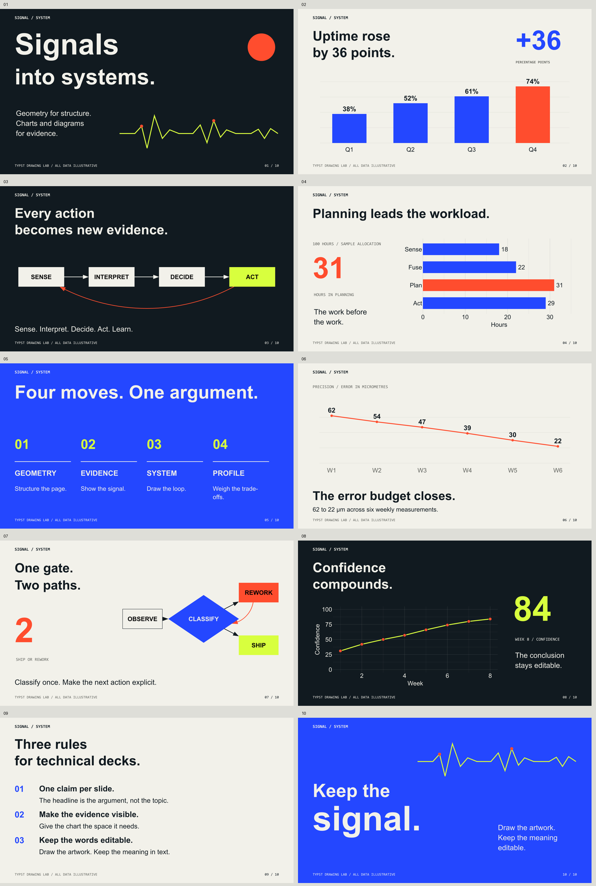

# Signal / System — Typst package showcase

A ten-slide editorial redesign combining Creative Deck Director's narrative and
composition audits with the pptx-typst design skill's editable IR and round-trip QA.



## Design rationale

The visual thesis is **signals become evidence, evidence becomes decisions**.
Three directions were considered: a calibrated instrument atlas, a sculptural
gallery, and a signal score built from line rhythm and branching paths.
The design combines the instrument atlas's precision with the signal score's
movement. A gallery direction risked making the technical evidence decorative.

The identity uses a recurring signal trace, blue evidence, orange emphasis and
lime feedback. Paper, night and cobalt fields vary with the story. Arial carries
the argument; Consolas labels the experiment. Compositions change with meaning:
full-width evidence, an open feedback loop, horizontal allocation bars, a
typographic map, a bottom-captioned trend, a branching gate, and a quiet close.
No slide-sized screenshots or decorative stock assets are used.

## Story and data

| Slide | Message | Visual |
| --- | --- | --- |
| 01 | Signals become systems | Geometric signal opener |
| 02 | Uptime rose by 36 percentage points | CeTZ bars: 38, 52, 61, 74% |
| 03 | Every action becomes new evidence | Fletcher four-stage feedback loop |
| 04 | Planning leads the workload | Gribouille allocation: 18, 22, 31, 29 hours |
| 05 | Four moves form one argument | Native editable typographic map |
| 06 | The error budget closes | CeTZ trend: 62, 54, 47, 39, 30, 22 micrometres |
| 07 | One gate creates two accountable paths | Fletcher branch with rework feedback |
| 08 | Confidence compounds | Gribouille scores: 31, 42, 50, 57, 66, 74, 80, 84 |
| 09 | A technical deck needs three rules | Native editable principles |
| 10 | Keep the signal | Geometric closing statement |

All data is illustrative and retained from the supplied draft. Visible copy is
authored locally in content blocks. General placement uses whole points;
fine dimensions and font sizes use 0.5 pt increments.

## Build

```console
pptx-typst compile main.typ --output "previews/slide-{p}.png" --ppi 144
pptx-typst compile main.typ --output "previews/slide-{p}.svg"
pptx-typst compile main.typ --output showcase.pdf
pptx-typst-fonts main.typ --report qa/font-report.json
typst-to-pptx main.typ --output exports/deck.pptx
pptx-to-typst exports/deck.pptx --output qa/restored
```

Pinned remote dependencies: [CeTZ 0.5.2](https://typst.app/universe/package/cetz/),
[Fletcher 0.5.8](https://typst.app/universe/package/fletcher/), and
[Gribouille 0.7.0](https://typst.app/universe/package/gribouille/).
The first compilation needs network access unless packages are cached. Typst
packages and system fonts are not bundled in the PowerPoint source snapshot.

## Deliverables and editability

- `showcase.pptx`: editable native slide text and shapes; package artwork as SVG.
- `showcase.pdf`: final native Typst rendering.
- `previews/`: PNG and SVG pages plus the whole-deck contact sheet.
- `main.typ`: complete authored source, including the chart and diagram code.
- `qa/verification.json`: compilation, source recovery, and viewing checks.

Eight static frames contain the six package demonstrations and two signal traces.
They remain native drawing code in Typst and export as vector SVG with PNG
fallbacks in PowerPoint. Chart internals and diagram labels are static in PPTX;
titles, conclusions, captions, and simple geometry remain editable.

## Verification

All ten native pages and PowerPoint renders were visually reviewed. Export
reported zero unsupported objects, 71 native text boxes, and eight SVG artwork
instances sharing seven vector parts. The entrypoint and local helper restore
byte-for-byte; all ten restored SVG pages match the authored renders exactly.
Arial and Consolas are available to both Typst and Office on the validation
machine. The example's parametrized round-trip regression also passed.
